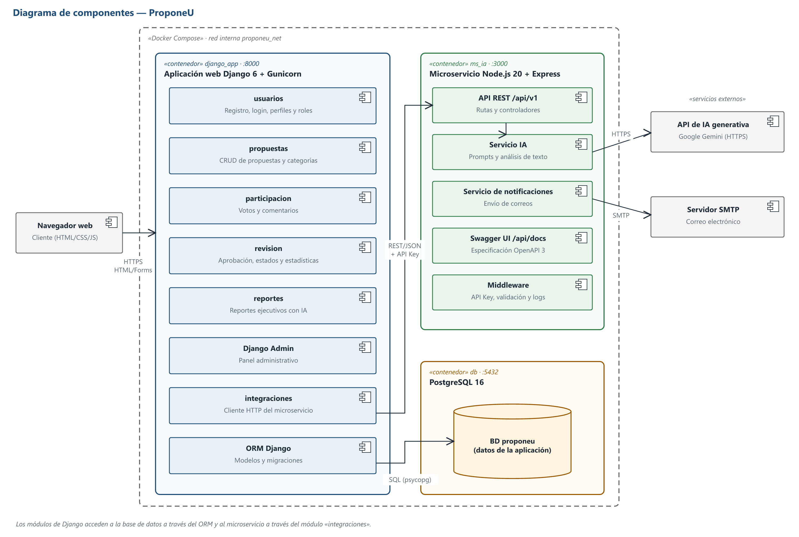

# ProponeU

**Plataforma web de propuestas académicas con inteligencia artificial**
Proyecto Integrador ExpoUninpahu 2026 · Programa de Ingeniería de Software · Uninpahu
Docente: Elfar Didier Morantes Sánchez

## Equipo

| Integrante | Rol |
| --- | --- |
| [Integrante 1] | [Rol] |
| [Integrante 2] | [Rol] |
| [Integrante 3] | [Rol] |
| [Integrante 4] | [Rol] |

## Problema

En Uninpahu, las ideas de estudiantes y docentes para actividades académicas complementarias
(talleres, charlas, semilleros, hackatones) circulan por canales informales como WhatsApp, correos
o papel. No hay un registro central, no se mide el interés de la comunidad y la coordinación
clasifica y responde cada propuesta a mano.

## Solución

ProponeU centraliza el ciclo de una propuesta: **crear → votar y comentar → revisar → responder**.
Un microservicio en Node.js integra IA generativa para resumir y clasificar propuestas, detectar
duplicados y generar reportes ejecutivos para la coordinación.

## Arquitectura



| Servicio | Tecnología | Responsabilidad |
| --- | --- | --- |
| `django_app` | Python 3.13 · Django 6 | Aplicación web, autenticación, roles, CRUD, votos, revisión, panel admin |
| `ms_ia` | Node.js 20 · Express · Swagger | API REST para análisis con IA y notificaciones por correo |
| `db` | PostgreSQL 16 | Persistencia (SQLite en desarrollo local) |
| Externos | Google Gemini API · SMTP | IA generativa y correo |

Despliegue: Render (dos Web Services con Docker + PostgreSQL gestionado). Ver [diagrama de despliegue](docs/uml/despliegue.png).

## Estructura del repositorio

```
├── django_app/        Aplicación Django (proyecto "problema")
├── ms_ia/             Microservicio Node.js (Entrega 3)
├── docs/
│   ├── SRS_ProponeU_Entrega1.docx
│   ├── backlog.md
│   ├── trazabilidad.md
│   ├── guion_video1.md
│   └── uml/           Casos de uso, componentes y despliegue (SVG y PNG)
├── .github/           Plantillas de issues y pull requests
└── .env.example       Variables de entorno necesarias
```

## Ejecución local (estado actual)

```bash
python -m venv venv
venv\Scripts\activate
pip install -r django_app/requirements.txt
cd django_app
python manage.py migrate
python manage.py createsuperuser
python manage.py runserver
```

En la Entrega 3 todo el sistema se levantará con `docker compose up`.

## Documentación

- [SRS — Entrega 1](docs/SRS_ProponeU_Entrega1.docx)
- [Backlog inicial](docs/backlog.md)
- [Matriz de trazabilidad](docs/trazabilidad.md)
- Diagramas UML: [casos de uso](docs/uml/casos_de_uso.png) · [componentes](docs/uml/componentes.png) · [despliegue](docs/uml/despliegue.png)

## Flujo de trabajo

Git Flow: `main` (producción) · `develop` (integración) · `feature/HUxx-descripcion` (una rama por historia).
Commits con Conventional Commits, por ejemplo `feat(propuestas): crear propuesta (HU04)`.

## Cronograma

| Fecha | Entrega | Contenido |
| --- | --- | --- |
| 05/11/2026 | Entrega 1 | SRS, UML inicial, backlog, repositorio, trazabilidad, video |
| 12/11/2026 | Entrega 2 | CRUD, login, roles, Dockerfile, despliegue inicial, diagrama de secuencia |
| 19/11/2026 | Entrega 3 | Microservicio Node.js, Swagger, IA, Docker Compose |
| 26/11/2026 | ExpoUninpahu | Sustentación del producto final |
